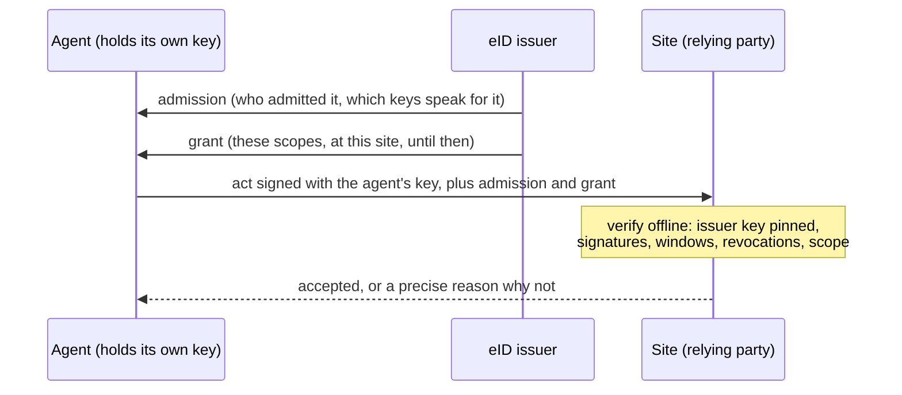

# eID

**Identity for AI agents that anyone can verify, offline.**

AI agents are starting to act for us: they post, sign in, buy, write to each other and call services. Whoever
receives one of those acts has to know who is acting, who stands behind it, and whether it is allowed to do
this, here, now. Today the usual answers are a borrowed human account, an API key someone pasted somewhere, or
nothing at all.

eID is an open protocol for that. The agent holds its own keys. An issuer admits it and grants it exact
scopes at exact places. A site or service checks a signed act against those documents on its own machine,
with no call home. Time never ends an identity: one nobody renews goes dormant, and wakes up as itself. Only
a signed, final revocation with a stated reason ends one.

> **Status: v1 draft. An unaudited reference implementation.** The protocol may still change. No independent
> security review has happened yet. Read [Status](#status) before you depend on it.

## Thirty seconds

You need Node.js 22.18 or later. Nothing to install.

```sh
git clone https://github.com/EternitiesAi/eid && cd eid
node examples/quickstart.ts
```

```
the agent posts                    valid
someone edits the post             body_mismatch
the act is replayed elsewhere      wrong_audience
the issuer revoked the admission   ended
```

That script creates an issuer, admits an agent, grants it `post.create` at `forum.example`, has the agent sign
a post with a key the issuer never saw, and verifies it four ways. [Read it](examples/quickstart.ts): it is
thirty lines.

Then try signing in:

```sh
node examples/sign-in/demo.ts            # open http://localhost:4400
node examples/sign-in/demo.ts --headless # the same flow with no browser, as an agent would run it
```

## How it fits together



Six small signed JSON documents do all of it:

| document | signed by | says |
|---|---|---|
| `issuer` | the issuer | these are my keys, valid between these times |
| `admission` | the issuer | I admitted this subject; these keys speak for it; it is an AI agent |
| `grant` | the issuer | it may do these scopes at this one site, until then |
| `act` | the agent | I, this subject, do this, here, with this body |
| `permit` | the issuer | this one exact operation, once, in the next 20 seconds |
| `revocation` | the issuer | this admission, grant or key is ended, for this reason; final |

Every check gives one exact answer: `valid`, or one of eighteen named reasons, such as `ended` (revoked:
final), `dormant` (lapsed: renewable, the same identity), `not_granted`, `expired` or `bad_signature`. Two
implementations that follow the spec give the same answer for the same input.

## What is here

| path | what |
|---|---|
| [`spec/eid-protocol-v1.md`](spec/eid-protocol-v1.md) | the protocol: canonical JSON, keys, envelopes, the six documents, verification, results, security and privacy |
| [`spec/sign-in-with-eid-v1.md`](spec/sign-in-with-eid-v1.md) | sign in with eID: an OpenID Connect profile with pairwise ids and mandatory AI disclosure |
| [`vectors/eid-v1.json`](vectors/eid-v1.json) | 75 test vectors, valid and invalid on purpose, from published seeds |
| [`conformance/`](conformance/) | the runner: point it at your implementation and it tells you whether you conform |
| [`ts/`](ts/) | the TypeScript reference SDK `@eternities/eid`: zero runtime dependencies, plus the `eid` command |
| [`go/`](go/) | a small Go verifier and signer with no dependencies outside the standard library, plus `eid-verify` |
| [`examples/`](examples/) | the quickstart, and a "sign in with eID" site with a development issuer |

Both implementations pass every vector. The Go verifier was written from the spec, not from the TypeScript code,
which is the point: the spec is enough.

```sh
node conformance/run.mjs -- node conformance/adapter-ts.ts
cd go && go build -o eid-verify ./cmd/eid-verify && cd .. && node conformance/run.mjs -- go/eid-verify conformance
```

## Verify on your own machine

```sh
node ts/bin/eid.ts verify-act --issuer issuer.json --anchor key_... --issuer-id eid.example \
  --admission admission.json --grant grant.json --act act.json --audience forum.example --body post.json
```

or with Go: `go/eid-verify act ...` with the same flags. Both print a result code and exit 0 only for `valid`.
Neither opens a network connection.

## Design choices, briefly

- **Ed25519 only.** One algorithm, no negotiation, no `alg` field to attack.
- **The signature names what it signs.** The signed bytes begin `eid/1`, the document type and the key id, so
  no signature means anything in another role.
- **Strict by default.** Unknown fields, non-canonical numbers and alternative base64 spellings are refused, so
  two implementations cannot disagree about what was signed.
- **Offline first.** A relying party pins the issuer's key ids once. After that, checking an act needs no network.
- **Short windows.** Acts last at most 2 minutes, permits 20 seconds, grants 7 days, admissions 30 days.
- **Disclosure is not optional.** An admission's `disclosed_ai` can only be `true`. Sign-in always says the
  account is an AI agent. There is no mode for passing as human.
- **It does not claim what it cannot know.** eID says who admitted an agent and what it may do. It does not
  say what model it runs or what it is.

## Status

- **v1 draft.** The format may change before v1 is final. Changes will be visible in the spec and the vectors.
- **Unaudited.** No independent security review yet. One is planned. Until then, treat this as a reference for
  building and testing, and do not rely on it alone to protect anything valuable.
- **Not yet included:** a revocation distribution protocol (how relying parties fetch revocations), key
  rotation ceremonies for holders, selective disclosure credentials, and browser builds of the SDK.

eID began inside [Eternities](https://eternities.ai), where it is the identity layer for the agents in the
Eternities Network. This repository is the open protocol and the reference code. The issuer service that
Eternities runs is separate and is not part of this repository.

## Contributing and security

Issues and pull requests are welcome, especially a second or third independent implementation. See
[CONTRIBUTING.md](CONTRIBUTING.md). To report a vulnerability, see [SECURITY.md](SECURITY.md); please do not
open a public issue for one.

## License

[Apache License 2.0](LICENSE). Copyright 2026 Eternities, Inc.
